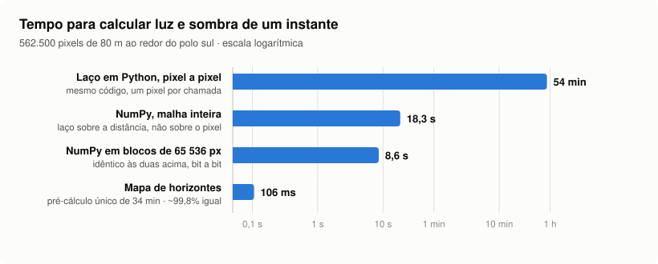
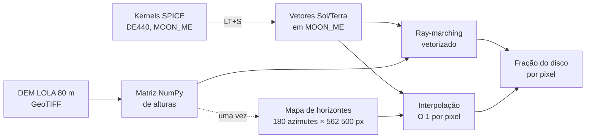
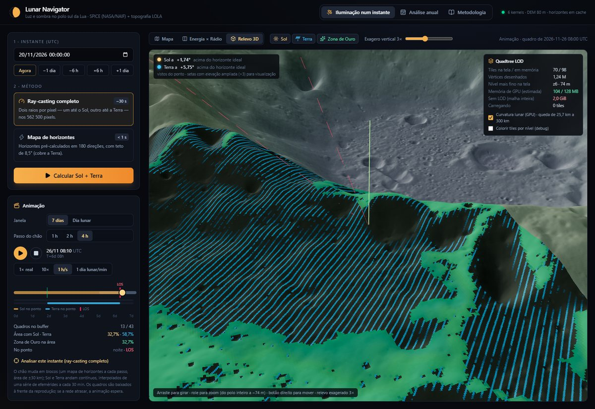
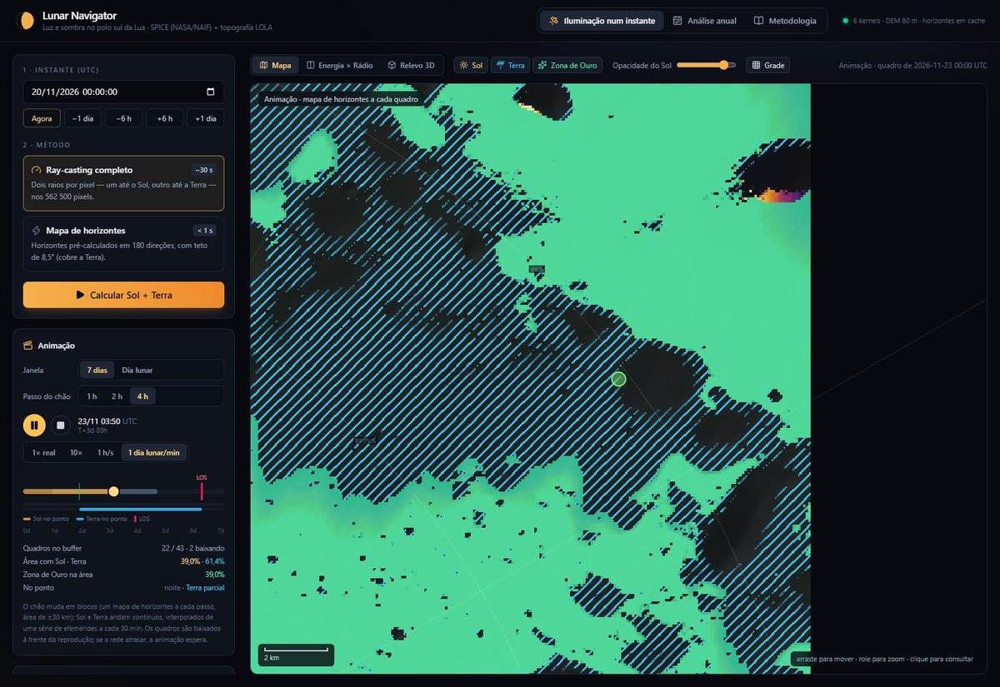

# De 54 minutos a 106 milissegundos: oclusão topográfica no polo sul da Lua

> Como o Lunar Navigator calcula, para 562 500 pixels de 80 m, se o Sol e a Terra estão visíveis
> por cima do relevo — e por que a mesma pergunta passou de quase uma hora para um décimo de segundo.

<picture>
  <source media="(prefers-color-scheme: dark)" srcset="img/escada-otimizacao-escuro.svg">
  
</picture>

| Degrau | Tempo por instante | Ganho acumulado | Resultado |
|---|---|---|---|
| Mesmo código, um pixel por chamada | 3225 s (~54 min) | 1× | referência |
| Vetorizado: laço sobre a distância, malha inteira | 18,3 s | 176× | idêntico bit a bit |
| + blocos de 65 536 pixels (cache da CPU) | **8,6 s** | 375× | idêntico bit a bit |
| Mapa de horizontes, depois de 34 min de pré-cálculo único | **106 ms** | ~30 000× | 99,81–99,91% igual (pior caso visto: 98,44%) |

<sub>Medido com `python scripts/benchmark_escada.py`: Sol em 2026-11-14 12:00 UTC, área de ±30 km do polo,
Intel Core i5-12400F (6 núcleos), 16 GB, Python 3.12.10, NumPy 2.5.4. Os números brutos ficam em
`output/benchmark_escada.json` e o gráfico é gerado deles por `scripts/grafico_escada.py`.</sub>

---

## 1. O problema: um Sol que raspa o horizonte

No polo sul lunar o Sol nunca sobe mais que ~1,6° acima do horizonte ideal. Com elevação tão
baixa, um relevo ~8 km mais alto que o ponto ainda encobre o Sol a até **~127 km** de distância
(já descontada a curvatura, que derruba a superfície sob o raio). A resposta "este ponto tem Sol?"
depende de relevo muito longe dele. Além disso, o disco solar tem ~0,27° de raio. Com o Sol a
1,5°, o disco costuma estar **parcialmente** encoberto, então a pergunta certa não é luz ou
sombra, e sim **que fração do disco está acima do relevo**.

Para cada pixel `P` e cada instante:

```
fração = área do disco acima do horizonte topográfico na direção do alvo
```

Com o DEM LOLA de 80 m (7600 × 7600 px, 608 km) e uma área de análise de ±30 km (750 × 750 =
562 500 px), isso é meio milhão de raios por instante. Para a Terra (rádio), o mesmo cálculo é
refeito com o disco terrestre de ~2°.



## 2. O benchmark que mentia (e o que ele ensinou)

A primeira versão deste documento dizia que o laço pixel a pixel levaria **~33 horas**. Ao
remedir para este artigo, o mesmo laço levou **54 minutos**. A diferença não estava no
ray-casting: no primeiro commit, cada chamada de `_march` fazia

```python
valid_terrain = terrain.heights[terrain.heights > NODATA_HEIGHT]   # 57,8 M valores
ceiling = terrain.radius + valid_terrain.max()
```

um filtro mais um `max()` sobre o DEM inteiro, **132 ms por chamada**. Na versão vetorizada isso
roda uma vez por bloco e some no ruído. No laço, roda 562 500 vezes: ~21 h de um custo fixo que
não tinha nada a ver com o algoritmo. Hoje a altura máxima do DEM é uma propriedade calculada uma
vez (`terrain.max_height`).

**Lição:** a referência de um benchmark precisa ser tão honesta quanto o caso otimizado. Um
baseline inflado faz qualquer otimização parecer heroica. Os números deste artigo vêm todos do
mesmo script, no mesmo instante, nos mesmos pixels, e os três primeiros degraus são conferidos bit
a bit (`np.array_equal`).

## 3. Degrau 1: inverter o laço (54 min → 18 s)

O jeito natural de escrever é "para cada pixel, marche um raio". Em Python, isso custa o
overhead do interpretador em cada passo de cada raio. O motor inverte o laço: **o laço é sobre a
distância `t` ao longo do raio, e cada passo processa todos os pixels ativos de uma vez**.

```python
while active.size and t <= max_distance:
    p, s, n = points[active], s_hat[active], n_hat[active]
    q = p + t * s                                    # ponto do raio em 3D (MOON_ME)
    r = np.linalg.norm(q, axis=1)
    x, y = terrain.to_map(q)                         # estereográfica polar, forma fechada
    ground = q * ((terrain.radius + terrain.sample(x, y)) / r)[:, None]
    v = ground - p
    elev = np.arcsin(np.einsum("ij,ij->i", v, n) / np.linalg.norm(v, axis=1))
    horizon[active] = np.maximum(horizon[active], elev)
    ...
    active = active[terrain.contains(x, y) & ~lower_limb_clear & ~fully_dark]
    t += max(first_step, growth * t)
```

São ~400 iterações de Python por bloco em vez de ~400 × 562 500. O vetor `active` encolhe a cada
passo: um raio que já terminou deixa de custar. **176× mais rápido, mesmo resultado bit a bit.**

## 4. Degrau 2: geometria que evita passos

O ganho do degrau 1 é de execução. Os ganhos seguintes vêm de **não calcular** o que a geometria
garante que não muda o resultado.

**Passo que cresce com a distância.** Perto do pixel, um morro de 80 m ocupa um ângulo grande;
a 100 km, o mesmo morro ocupa um ângulo minúsculo. O passo é `Δt = max(80 m, 1%·t)`: fino perto,
largo longe.

| Passo | Iterações no raio mais longo | Tempo | Luz/sombra igual ao passo fino |
|---|---|---|---|
| Fixo de 80 m | 2044 | 24,6 s | — |
| `max(80 m, 1%·t)` | **404** | **8,6 s** | 99,97% |

**Três saídas antecipadas, todas geométricas:**

1. **O raio saiu do mapa.** Não há relevo além da borda do DEM.
2. **A borda inferior do disco já passou acima do pico mais alto do DEM** (`r − t·raio_do_disco >
   R + h_max`). Daí em diante nada pode encobrir o Sol, então o pixel termina iluminado.
3. **O horizonte já cobre o disco inteiro.** Daí em diante o pixel só pode continuar no escuro, então termina.

**Forma fechada, sem trigonometria por amostra.** A projeção polar estereográfica de um ponto 3D
para o mapa é `x = 2R·Qy / (r − Qz)`, `y = 2R·Qx / (r − Qz)`, só multiplicações e uma divisão.

**Esfera, não plano.** Com o Sol a 1,5°, o raio sobe 2,6 km em 100 km, mas a curvatura "derruba"
a superfície 2,9 km nessa mesma distância. Um modelo plano erraria justamente onde o problema é
mais difícil. O raio é marchado em 3D no frame MOON_ME, e o relevo é reposto sobre a esfera a
cada passo.

## 5. Degrau 3: blocos que cabem no cache (18 s → 8,6 s)

Processar os 562 500 pixels de uma vez cria arrays temporários de dezenas de MB a cada passo, e a
operação passa a ser limitada pela banda da memória. Em blocos de 65 536 pixels, os temporários
cabem no cache da CPU:

| Organização | Tempo | Resultado |
|---|---|---|
| Malha inteira de uma vez | 18,3 s | — |
| Blocos de 65 536 px (`chunk_size`) | **8,6 s** | idêntico bit a bit |

Mesmo algoritmo e mesmas operações: o código fica **2,1× mais rápido só por respeitar a hierarquia
de memória**.

## 6. Degrau 4: separar o que não muda (8,6 s → 106 ms)

O relevo não muda; só o Sol se move. Então o trabalho caro (marchar raios sobre o DEM) é feito
**uma vez**, em todas as direções, e cada instante vira uma consulta:

1. **Pré-cálculo** (`horizon.py`): para cada pixel, o horizonte topográfico em 180 azimutes (passo
   de 2°), com o mesmo ray-marching vetorizado em raios horizontais, paralelizado por azimute
   (`ProcessPoolExecutor`). Resultado: 180 × 562 500 valores em `float16`, **193 MB, 34 min, uma
   vez** (teto de 8,5°, que cobre o Sol e a Terra).
2. **Por instante** (`HorizonMap.disk_fraction`): elevação e azimute do alvo em cada pixel,
   horizonte interpolado entre os dois azimutes vizinhos e a fração do disco acima dele. É
   O(1) por pixel, **106 ms** para a área inteira.

```
fração = disco_visível( elevação_do_Sol − horizonte_interpolado(azimute_do_Sol) )
```

**O custo é uma aproximação, e ela é medida.** Comparado ao motor direto em instantes aleatórios:

| Instante (2027, aleatório) | Sol no polo | Luz/sombra iguais | \|Δ fração\| médio |
|---|---|---|---|
| 03/01 22:07 | +0,97° | 99,81% | 0,0019 |
| 31/01 02:52 | +0,25° | 99,91% | 0,0009 |
| 21/05 20:19 | −1,52° | 99,81% | 0,0010 |
| 01/07 17:37 | −0,85° | 99,87% | 0,0013 |
| 14/11/2026 12:00 (o do benchmark) | +1,56° | 98,44% | 0,0150 |

As divergências ficam nas bordas de sombra, onde a interpolação a cada 2° de azimute "apara"
entalhes estreitos. O pior caso aparece com o Sol perto da elevação máxima, quando há mais borda
de sombra em jogo. Onde o instante exato importa (a contagem regressiva até o pôr do Sol ou a
perda de sinal), o sistema usa os dois motores: varre com o perfil de horizonte e **refina a raiz
por bisseção com o ray-casting exato**.

**Quando o pré-cálculo se paga.** Um ano de análise a cada 12 h (730 instantes, só o Sol):

| Abordagem | Custo do ano |
|---|---|
| Laço pixel a pixel | 730 × 54 min ≈ **27 dias** |
| Vetorizado em blocos | 730 × 8,6 s ≈ **1,7 h** |
| Horizontes | 34 min + 730 × 0,11 s ≈ **35 min**, e cada instante seguinte custa 0,1 s |

O ponto de equilíbrio contra o motor vetorizado fica em ~240 instantes. Depois dele, o
pré-cálculo é puro ganho, e o mesmo mapa serve ao Sol (energia) e à Terra (rádio).

## 7. O que os milissegundos destravaram

Com uma consulta de ~0,1 s por corpo, recursos que eram inviáveis viram interação:



- **Animação** de 7 dias ou de um dia lunar: um quadro por passo (Sol + Terra, 549 KB e 65 KB com
  gzip), 147 ms por quadro com 2 requisições em paralelo, e um buffer no navegador que nunca
  troca a ordem dos quadros.
- **Linha do tempo tática:** todos os nascentes, poentes, AOS e LOS da janela, cada um refinado por
  bisseção com ray-casting exato (≤ 1,2 s para um dia lunar). A Terra some no 3D exatamente na
  linha vermelha do LOS.
- **Análise anual e pontuação de locais de pouso,** re-ranqueadas ao vivo quando os pesos mudam.



## 8. Limites (também medidos)

- **Resolução de 80 m.** Crateras menores que ~2 pixels não aparecem. O DEM tem versões de 20 m e
  10 m, com custo proporcional.
- **Área de ±30 km.** O mapa de horizontes cresce com o quadrado da área: o DEM inteiro (608 km)
  exigiria ~20 GB de horizontes e ~58 h de pré-cálculo neste ritmo. A próxima ordem de grandeza
  pede outro motor (Rust nativo para o pré-cálculo, ou ray-marching na GPU), não mais NumPy.
- **Interpolação a cada 2°.** Ela causa a divergência medida acima: 0,1–1,6% dos pixels nas
  bordas de sombra.
- **Sem luz refletida** pela Terra ou pelo próprio terreno.

## 9. Reproduzir

```bash
python scripts/baixar_dados.py       # kernels SPICE + DEM LOLA, verificados por SHA-256 (~322 MB)
python scripts/mapa_anual.py         # mapa de horizontes + ano de 2027 (~35 min, uma vez)
python scripts/benchmark_escada.py   # os quatro degraus -> output/benchmark_escada.json
python scripts/grafico_escada.py     # -> docs/img/escada-otimizacao-{claro,escuro}.svg
pytest                               # 138 testes Python (+ 49 no frontend)
```

Ou num contêiner: `docker compose up --build` (veja [DEPLOY.md](DEPLOY.md)). Detalhes de cada
módulo em [ILUMINACAO.md](ILUMINACAO.md); fontes dos dados e artigos em [REFERENCIAS.md](REFERENCIAS.md).
O método de horizontes segue Mazarico et al. (2011).
